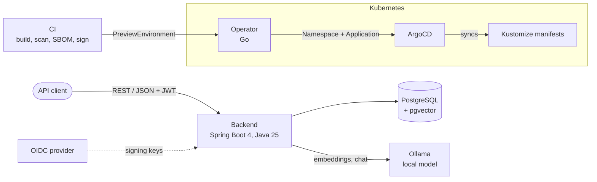

# Almanac

Almanac is a self-hosted task manager with natural-language search over your own
documents, answered by a locally run LLM so the documents never leave your
infrastructure.

It is built as a small production-style platform: a Spring Boot API secured as an
OAuth2 resource server, a Go Kubernetes operator that creates per-pull-request preview
environments with a TTL, GitOps delivery through ArgoCD, a scanned and signed supply
chain, and Terraform for GKE and EKS.

> **Status:** early development. The Spring Boot backend is scaffolded; the other
> components below are planned. Sections marked *planned* describe intended design,
> not working code.

## Architecture

Target architecture (most components planned):



| Component | Stack | Status |
| - | - | - |
| Backend API | Java 25, Spring Boot 4 (Spring MVC), Spring Data JPA, Flyway | Scaffolded |
| Database | PostgreSQL 17 with pgvector | Used in tests via Testcontainers |
| Document search | Spring AI, Ollama, RAG over user documents | Planned |
| Auth | Spring Security OAuth2 resource server (JWT) | Planned |
| Operator | Go, kubebuilder / controller-runtime; per-PR preview environments with a TTL | Planned |
| Deployment | Docker, Kustomize, ArgoCD on a local kind cluster | Planned |
| CI | GitHub Actions: Trivy scan, Syft SBOM, cosign signing | Planned |
| Observability | Micrometer, OpenTelemetry, Prometheus, Grafana | Planned |
| Infrastructure | Terraform + Terragrunt for GKE and EKS | Planned |

## Repository layout

```
backend/          Spring Boot API
deploy/compose/   docker-compose for local dependencies (Postgres)
docs/adr/         Architecture decision records
```

Planned: `operator/`, `deploy/k8s/` (Kustomize), `deploy/argocd/`, `infra/`
(Terraform + Terragrunt), `.github/workflows/`.

## Running locally

**Prerequisites:** JDK 25 and a running Docker daemon. The Gradle wrapper downloads
Gradle itself.

Start the backend with a throwaway Postgres (pgvector) container managed by
Testcontainers:

```bash
cd backend
./gradlew bootTestRun
```

The API listens on `http://localhost:8080`. Spring Boot Actuator's health endpoint
is at `/actuator/health`.

Run the tests (also requires Docker):

```bash
cd backend
./gradlew test
```

### Local Postgres (Docker Compose)

A long-lived Postgres (pgvector) container for local development, using the same
image as the tests. It binds to `127.0.0.1` only. No secrets are required for local
development; the values in `.env.example` are local defaults.

Run these from the repository root:

```bash
cp .env.example .env    # optional: every variable has a default in the compose file
docker compose --env-file .env -f deploy/compose/docker-compose.yml up -d
docker compose -f deploy/compose/docker-compose.yml ps    # wait for "(healthy)"
```

Open a `psql` shell:

```bash
docker compose -f deploy/compose/docker-compose.yml exec postgres psql -U almanac -d almanac
```

Stop it (`down -v` also deletes the data volume):

```bash
docker compose -f deploy/compose/docker-compose.yml down
```

`POSTGRES_*` values apply only when the data volume is first initialized. After
changing them in `.env`, recreate the volume with `down -v`.

## Design decisions

Recorded as ADRs in `docs/adr/` as they are made. Decisions that shape the current
code:

- **Spring MVC, not WebFlux.** The blocking servlet model keeps code and stack traces
  simple. Requests run on virtual threads, so blocking I/O no longer ties up a
  platform thread per request, which removes the main scaling argument for going
  reactive. See [ADR 0001](docs/adr/0001-virtual-threads-for-request-handling.md).
- **Postgres + pgvector for both relational data and embeddings.** One database to
  run, back up, and query transactionally, instead of a separate vector store.
- **Real Postgres in tests.** Integration tests run against a pgvector container via
  Testcontainers rather than an in-memory substitute, so migrations and queries are
  tested against the same engine used in production.
- **Schema managed by Flyway.** Versioned SQL migrations, applied at startup.
- **Preview environments through an operator, delivered by ArgoCD** (planned). The operator
  owns the lifecycle (namespace, TTL, status); ArgoCD owns the manifests. See
  [ADR 0002](docs/adr/0002-operator-managed-preview-environments.md).

## License

[MIT](LICENSE)
