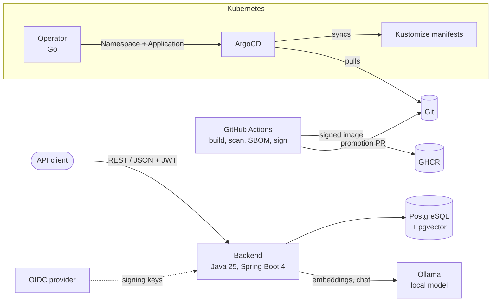

# Almanac

Almanac is a self-hosted task manager with natural-language search over your own
documents, answered by a locally run LLM so the documents never leave your
infrastructure.

The core is application code in two languages: a **Java 25 / Spring Boot 4 API** and
a **Go Kubernetes operator** that gives each pull request its own short-lived preview
environment. Around them sits the platform that ships them: GitOps delivery through
ArgoCD, a scanned and signed supply chain, and Terraform for AWS EKS.

> **Status:** early development. The `tasks` REST API is complete and tested against
> real Postgres, and CI runs on every pull request. The operator is next. Sections
> marked *planned* describe intended design, not working code.

## The code

### Java: tasks API (`backend/`)

Spring Boot 4 on Java 25, Spring MVC on virtual threads, Spring Data JPA, and Flyway
on PostgreSQL. See [backend/README.md](backend/README.md) for endpoints and layout.

- **Domain rules live in the domain.** `TaskStatus` defines the allowed moves
  (`TODO` → `IN_PROGRESS` or `DONE`, `IN_PROGRESS` → `DONE`, `DONE` → `TODO`), and
  `Task` has no status setter, so every change goes through that check. A rejected
  move is its own exception type and reaches the client as `409 Conflict`.
- **No lost updates.** `Task` carries a `@Version` column. When two requests edit the
  same task, the second write fails at flush and returns `409`; the first writer's
  change is kept.
- **Entities stay behind the service.** Controllers take and return records; JPA
  entities never cross the HTTP boundary.
- **Errors as RFC 9457 problem details**, including which fields failed validation.
- **Tests at three levels:** plain JUnit for the domain rules, `@WebMvcTest` and
  `@DataJpaTest` slices, and full-stack integration tests against a real Postgres
  container (Testcontainers). The concurrency test does not rely on thread timing:
  it commits a competing write at the exact point before flush, so the conflict
  happens on every run.

### Go: preview-environment operator (`operator/`, *planned, next*)

A kubebuilder / controller-runtime operator for a cluster-scoped `PreviewEnvironment`
resource (`spec.image`, `spec.ttl`). Each reconcile is idempotent:

1. Ensure an owned Namespace `preview-<name>`.
2. Ensure an owned ArgoCD `Application` for the preview overlay, with the image and
   namespace overridden. Manifests stay in Kustomize; the operator never renders
   workloads itself.
3. Mirror the Application's sync and health into status conditions.
4. Requeue at `status.expiresAt`, then delete the resource; garbage collection
   removes everything it owns.

Controller tests run against a real API server with envtest. See
[ADR 0002](docs/adr/0002-operator-managed-preview-environments.md).

## Architecture

Target architecture (most components planned):



| Component | Stack | Status |
| - | - | - |
| Backend API | Java 25, Spring Boot 4 (Spring MVC), Spring Data JPA, Flyway | Tasks API complete |
| Operator | Go, kubebuilder / controller-runtime; per-PR preview environments with a TTL | Next |
| Database | PostgreSQL 17 with pgvector | Testcontainers in tests; Docker Compose for local development |
| Document search | Spring AI, Ollama, RAG over user documents | Designed ([ADR 0005](docs/adr/0005-document-search-with-spring-ai-and-pgvector.md)); not built |
| Auth | Spring Security OAuth2 resource server (JWT) | Planned |
| Deployment | Docker, Kustomize, ArgoCD on a local kind cluster | Planned |
| CI/CD | GitHub Actions: per-component checks, Trivy scan, Syft SBOM, cosign signing, preview environment test on kind, promotion by pull request | Backend checks in place; the rest planned |
| Observability | Micrometer, OpenTelemetry, Prometheus, Grafana | Planned |
| Infrastructure | Terraform for AWS (EKS, ECR, IAM) | Planned |

### Roadmap

Built in this order, each piece merged with its tests and docs before the next starts:

1. **Operator** (next): the `PreviewEnvironment` API and reconciler in Go, tested
   with envtest, with its own CI checks (gofmt, go vet, golangci-lint, generated-code
   drift).
2. **Container image pipeline**: Dockerfile, plus a reusable workflow that scans the
   image, generates an SBOM, and on `main` publishes and signs it.
3. **Kubernetes manifests and ArgoCD**: Kustomize base and overlays for a local kind
   cluster, including Postgres as a single-replica StatefulSet. Then a pull request
   job that runs a preview environment on kind inside the runner.
4. **Document search**: ingestion, retrieval, and answers over pgvector with a local
   Ollama model.
5. **Auth and observability**: JWT resource server, metrics and traces.
6. **Terraform for AWS**: EKS, ECR, and IAM, validated with `plan`.

## Repository layout

```
backend/            Spring Boot API (see backend/README.md)
deploy/compose/     docker-compose for local dependencies (Postgres, Ollama)
docs/adr/           Architecture decision records
.github/workflows/  CI workflows
```

Planned: `operator/` (Go), `deploy/k8s/` (Kustomize), `deploy/argocd/`, `infra/`
(Terraform for AWS).

## Running locally

**Prerequisites:** JDK 25 and a running Docker daemon. The Gradle wrapper downloads
Gradle itself.

Start the backend with a throwaway Postgres (pgvector) container managed by
Testcontainers:

```bash
cd backend
./gradlew bootTestRun
```

The API listens on `http://localhost:8080`. Spring Boot Actuator's health endpoint
is at `/actuator/health`.

Run the tests (also requires Docker):

```bash
cd backend
./gradlew test
```

### Local Postgres (Docker Compose)

A long-lived Postgres (pgvector) container for local development, using the same
image as the tests. It binds to `127.0.0.1` only. No secrets are required for local
development; the values in `.env.example` are local defaults.

Run these from the repository root:

```bash
cp .env.example .env    # optional: every variable has a default in the compose file
docker compose --env-file .env -f deploy/compose/docker-compose.yml up -d
docker compose -f deploy/compose/docker-compose.yml ps    # wait for "(healthy)"
```

Open a `psql` shell:

```bash
docker compose -f deploy/compose/docker-compose.yml exec postgres psql -U almanac -d almanac
```

Stop it (`down -v` also deletes the data volume):

```bash
docker compose -f deploy/compose/docker-compose.yml down
```

`POSTGRES_*` values apply only when the data volume is first initialized. After
changing them in `.env`, recreate the volume with `down -v`.

### Local Ollama (Docker Compose)

The same `up -d` also starts Ollama, bound to `127.0.0.1` only. The one-shot
`ollama-pull` service downloads the models set in `.env` (several GB on first run)
and then exits. The backend does not call Ollama yet.

Check that the download finished and the models are available:

```bash
docker compose -f deploy/compose/docker-compose.yml logs -f ollama-pull
curl -s localhost:11434/api/tags
```

Docker on macOS has no access to the Apple GPU, so Ollama runs on the CPU here.
Embeddings are usable, but expect slow chat responses.

## Design decisions

Recorded as ADRs in `docs/adr/` as they are made.

**In the code today**

- **Spring MVC, not WebFlux.** The blocking servlet model keeps code and stack traces
  simple. Requests run on virtual threads, so blocking I/O no longer ties up a
  platform thread per request, which removes the main scaling argument for going
  reactive. See [ADR 0001](docs/adr/0001-virtual-threads-for-request-handling.md).
- **Optimistic locking over row locks.** Conflicting edits to one task are rare, so
  a version check at write time costs nothing on the common path and turns the rare
  conflict into a clear `409` instead of a silent overwrite.
- **Real Postgres in tests.** Integration tests run against a pgvector container via
  Testcontainers rather than an in-memory substitute, so migrations and queries are
  tested against the same engine used in production.
- **Schema owned by Flyway.** Versioned SQL migrations, applied at startup; Hibernate
  only validates that the entities match.
- **Postgres + pgvector for both relational data and embeddings.** One database to
  run, back up, and query transactionally, instead of a separate vector store.

**Planned**

- **Preview environments through an operator, delivered by ArgoCD.** The operator
  owns the lifecycle (namespace, TTL, status); ArgoCD owns the manifests. See
  [ADR 0002](docs/adr/0002-operator-managed-preview-environments.md).
- **Document search on Spring AI and pgvector.** A pinned local embedding model, a
  vector table created by Flyway rather than by the library, and an owner on every
  document so retrieval is scoped per user before auth exists. See
  [ADR 0005](docs/adr/0005-document-search-with-spring-ai-and-pgvector.md).
- **GitHub Actions for CI and promotion, ArgoCD for delivery.** Every pull request
  builds, scans, and runs the backend in a preview environment on a kind cluster
  inside the runner. Images from `main` are signed with cosign keyless signing and
  promoted by a pull request that pins the new digest; ArgoCD syncs the merge. CI
  never holds cluster credentials. See [ADR 0004](docs/adr/0004-ci-cd-on-github-actions.md).
- **One cloud target, AWS.** Workloads are cloud-agnostic, so a second cloud would
  double the infrastructure code without exercising anything new. Plain Terraform for
  EKS, ECR, and IAM, one root per environment. See
  [ADR 0003](docs/adr/0003-single-cloud-target-aws.md).

## License

[MIT](LICENSE)
